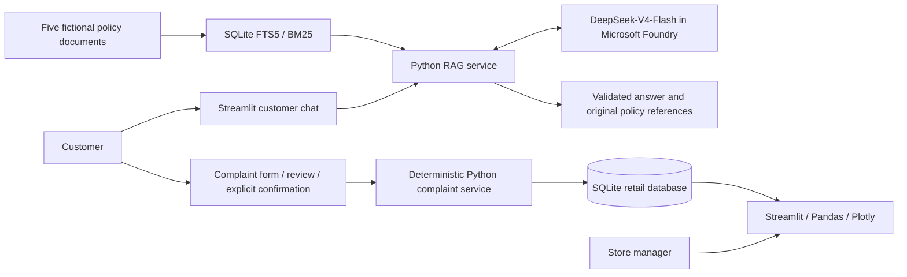
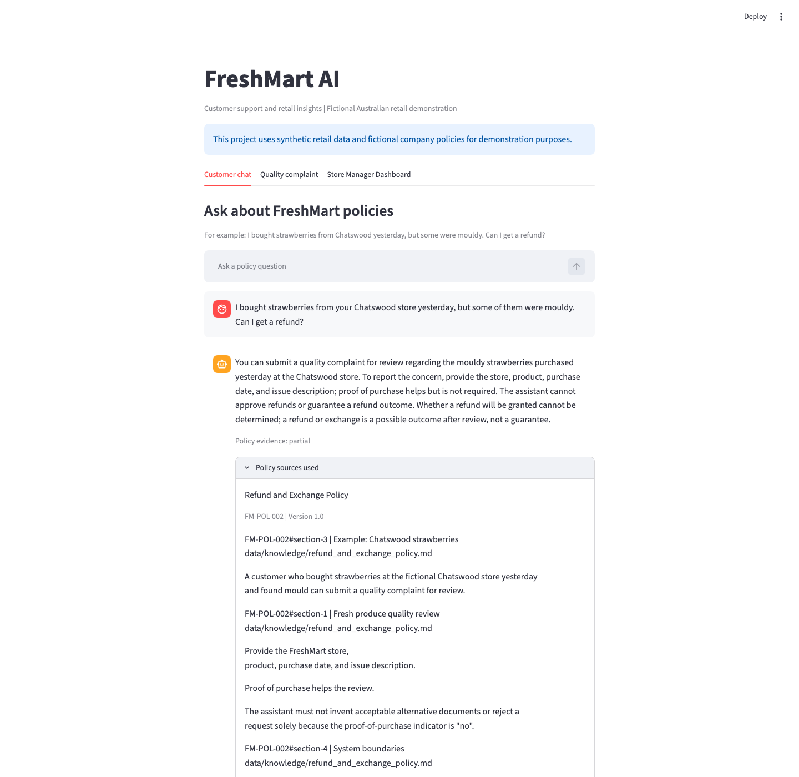
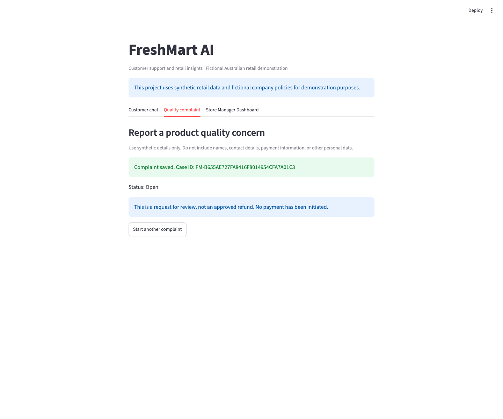
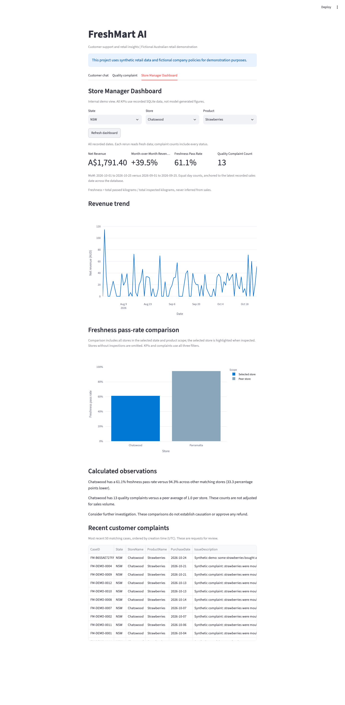

# FreshMart AI

**Grounded customer support, confirmed complaint intake, and retail quality insights.**

This project uses synthetic retail data and fictional company policies for demonstration purposes.

FreshMart Australia is a fictional six-store supermarket chain. This working
Python proof of concept follows one customer concern from a policy question to
an actual SQLite case and a manager's dashboard. It demonstrates Microsoft
Foundry model inference, not an automated refund approval or payment system.

## Business problem

Customer service teams repeatedly explain produce policies and manually record
quality concerns. Managers need to connect these reports with inspection results
and sales rather than examine disconnected spreadsheets.

The demo scenario is mouldy strawberries purchased at the fictional Chatswood
store. The objective is consistent policy guidance, reliable complaint capture,
and earlier visibility of a possible quality problem. Business savings and
customer satisfaction improvements have **not** been measured in a real retailer.

## Architecture



The search index is separate from operational tables. The model has no database
write tool. Cited answers normally use two calls to the **same existing
DeepSeek-V4-Flash deployment**: generation and a bounded grounding/status check.
There are no embeddings, Foundry agents, or additional models.

See [implementation details](docs/architecture.md) and the
[proposed Microsoft enterprise architecture](docs/microsoft_enterprise_solution.md).

## Technology stack

| Component | Implemented technology |
|---|---|
| Customer interface and manager dashboard | Python, Streamlit |
| Model inference | Microsoft Foundry, OpenAI-compatible v1 API, official OpenAI Python SDK |
| Policy retrieval | SQLite FTS5, keyword synonyms, weighted BM25 |
| Operational storage | SQLite, parameterized SQL, transactions |
| Analytics and charts | Pandas, Plotly |
| Local configuration and validation | python-dotenv, Pytest, Streamlit AppTest |

**Azure AI Search, Azure Blob Storage, Copilot Studio, Power Automate, Azure SQL,
Power BI, Entra-based application access, and Azure Monitor are proposed
enterprise services, not implemented POC components.**

## Features

- Genuine policy-grounded Foundry answers with document titles, versions,
  grouped section summaries, document/section IDs, original excerpts, and source paths.
- Helpful quality-policy guidance pointing to the existing **Quality complaint**
  form; chat guidance never submits a complaint or approves a refund.
- `supported`, `partial`, and `unsupported` evidence classifications; no fabricated
  answer when model inference fails.
- Customer chat history retained during the Streamlit session.
- Database-backed store/product choices, validated complaint details, review,
  and explicit confirmation before an `Open` case is saved.
- Actual UUID-based Case IDs and database-enforced submission-token uniqueness
  to prevent duplicates from retries and reruns.
- State/store/product dashboard filters, calculated KPIs, revenue trend,
  freshness comparison, and recent complaints, including newly submitted cases.
- Reproducible generation of six stores, four products, 2,000 sales lines,
  150 inspections, and 25 historical complaints across 90 days.

## Application screenshots

Actual browser captures from the running application, using seed `42` and a
dataset ending `2026-10-25`. The answer was generated by the deployed Foundry
model; the Case ID and dashboard values came from an isolated SQLite demo.
Dates, generated identifiers, counts, and model wording can differ in your run.
These recorded captures predate the final prompt and source-summary improvements.

### Customer support and policy evidence



### Confirmed quality complaint



### Store Manager Dashboard



## Local installation

Prerequisites: Git, Python 3.11+, SQLite 3.31+ with FTS5, and an existing
`DeepSeek-V4-Flash` deployment for live chat. Offline tests, complaints, and
analytics do not call Azure. Final validation used Python 3.14.5 on macOS;
other platforms and Python versions have not all been independently tested.

```bash
git clone https://github.com/ShawnYu99/freshmart-ai.git
cd freshmart-ai
python3 -m venv .venv
source .venv/bin/activate
python -m pip install -r requirements.txt
test -f .env || cp .env.example .env
python -m scripts.generate_data --seed 42
```

On Windows PowerShell, activate with `.venv\Scripts\Activate.ps1` and copy the
template only if `.env` does not already exist. Never overwrite working credentials.
Edit `.env` as described below, then launch:

```bash
python -m streamlit run app.py
```

Open **http://localhost:8501**. The application initializes/migrates existing
FreshMart storage and indexes the policies once per session. It does not silently
generate or overwrite a missing database. Do not rerun generation against a
populated database just to start the app.

For exact synthetic-data reproduction, supply both seed and date:

```bash
python -m scripts.generate_data --db data/reproducible.db --seed 42 --end-date 2026-10-25
```

To deliberately restore the default demo, stop the app first:

```bash
python -m scripts.reset_demo --yes --seed 42
```

**Reset replaces all five retail tables, including newly submitted complaints.**
It preserves unrelated tables/files and the separate policy index. An explicit
`--end-date` reproduces an earlier date window; omitting it ends the window today.

## Environment configuration

Keep values in the ignored `.env` or exported environment variables:

| Variable | Purpose |
|---|---|
| `FOUNDRY_BASE_URL` | HTTPS Foundry resource base URL ending in `/openai/v1/` |
| `FOUNDRY_MODEL` | Existing deployment name: `DeepSeek-V4-Flash` |
| `FOUNDRY_API_KEY` | Resource API key; never commit or include in screenshots |
| `FRESHMART_DB_PATH` | Optional SQLite path; default `data/freshmart.db` |

The app and live Foundry scripts load the repository's `.env`, preserving
exported overrides. Generation/reset scripts use `--db` or an **exported**
`FRESHMART_DB_PATH`; they do not automatically load `.env`. If you customize the
application path, generate that same database explicitly.

Use the deployed model's **View code** information in Microsoft Foundry to
confirm the resource endpoint, deployment name, and supported authentication.
Do not use a project endpoint ending in `/api/projects/...`. The current client
uses API-key authentication and `/openai/v1/chat/completions`, with no dated
`api-version`. It does not provision Azure resources or switch to another model.

New users need access to a supported existing deployment and its credentials.
Reusing the working deployment requires no Azure configuration changes. Entra
authentication is an enterprise improvement, not an implemented fallback.

Verify your actual deployment:

```bash
python scripts/test_foundry.py
python scripts/test_rag.py --question "I bought mouldy strawberries. Can I get a refund?"
```

Live calls require network access, valid configuration, quota, and can incur
charges. Each model request has a 60-second timeout and no automatic retries;
cited answers usually make two sequential requests. Authentication, endpoint,
quota, network, and invalid-output failures are surfaced rather than replaced
with mocked answers.

Official guidance: [Foundry v1 endpoints](https://learn.microsoft.com/en-us/azure/foundry/openai/api-version-lifecycle)
and [SDK/authentication](https://learn.microsoft.com/en-us/azure/foundry/openai/supported-languages).

## Demo workflow

1. In **Customer chat**, ask: "I bought strawberries from your Chatswood store
   yesterday, but some of them were mouldy. Can I get a refund?"
2. Read the actual answer and expand **Policy sources used**. Permission to
   request a review is not a final refund decision.
3. In **Quality complaint**, choose Chatswood and Strawberries, enter the
   purchase date and a synthetic issue description, optionally indicate proof
   of purchase, and select **Review complaint**.
4. Check the summary, explicitly confirm, and submit. Copy the actual Case ID;
   status is `Open`. No refund is approved and no payment is initiated.
5. In **Store Manager Dashboard**, select **NSW -> Chatswood -> Strawberries**.
   Use **Refresh dashboard** to see committed cases from other sessions.

Verify a saved case directly, replacing the path if configured differently:

```bash
sqlite3 data/freshmart.db \
  "SELECT CaseID, Status, StoreID, ProductID, PurchaseDate FROM complaints WHERE CaseID = 'PASTE_CASE_ID';"
```

The optional `sqlite3` command-line tool is separate from Python's built-in
SQLite module; the application and tests do not require that command.
Use the [five-minute interview script](docs/interview_demo_script.md) for the
customer-led presentation.

## Dashboard calculations

| KPI | Calculation and scope |
|---|---|
| Net Revenue | Sum of quantity x integer unit-price cents, then convert to AUD |
| Month-over-Month Revenue Growth | Equal-day ranges in the latest recorded sales month and previous month; `N/A` for insufficient history or zero prior revenue |
| Freshness Pass Rate | `SUM(PassedKg) / SUM(InspectedKg)`; no inspected weight means `N/A` |
| Quality Complaint Count | Every matching case, regardless of status; recent table displays only the latest 50 |

Except for growth, metrics cover all recorded dates. October 1-25 is compared
with September 1-25; March after a 28-day February uses March 1-28 versus
February 1-28. Exact periods are displayed and anchored to the database-wide
latest sales date, not today. Zero current revenue with a positive prior period
is a valid -100% change.

All three filters govern KPIs, trend, and complaints. The freshness comparison
intentionally retains peer stores under the same state/product filters and
highlights the selected store. Inspection rates are weight-based, never inferred
from sales. Peer complaint counts are not sales-adjusted, and comparisons do not
establish causation. The dashboard makes no model calls.

## Testing instructions

Deterministic tests use temporary databases and mocked SDK transport **only in
tests**; no Azure configuration is required:

```bash
python -m pytest -q
python -m pip check
```

They cover data relationships, reset/migration safety, input validation,
transactions, concurrent retry protection, RAG output/citation validation,
service errors, dashboard arithmetic, comparable periods, filters, empty data,
and Streamlit interactions.

Live integration checks are explicit and separate:

```bash
python scripts/test_foundry.py
python scripts/test_rag.py --document-injection
```

The latter runs seven policy/attack scenarios plus an injected-document scenario.
The document attack modifies only an in-memory passage, not the policy files or
index. Unsupported no-match questions do not call the model or invent citations.
Use `--debug` only locally with synthetic questions; it logs redacted final-answer
diagnostics, not hidden reasoning or raw SDK responses.

See the dated [final validation checklist](docs/validation.md) for actual results,
review scope, and the distinction between offline tests and genuine live evidence.

## Security and limitations

- All stores, transactions, inspections, complaints, and policies are fictional.
  Do not enter real personal data in free-text fields. This is not legal advice.
- `.env`, generated databases/journals, logs, and virtual environments are
  ignored. `.env.example` contains placeholders only. Never force-add secrets;
  rotate any credential accidentally exposed outside this repository.
- The app has no authentication or customer/manager authorization boundary.
  Local SQLite is not encrypted by the application. Run locally, not as a public
  production service.
- Session state survives reruns, not new sessions or server restarts. Idempotency
  protects retries of the same reviewed request, not deliberate cross-session
  duplicate reports. Proof of purchase is an indicator, not a file upload.
- Retrieval is lexical FTS5, not semantic search. Prior chat messages are
  displayed but not supplied as conversational model context. Policy changes
  require reindexing/restarting the session.
- Citations resolve only to retrieved excerpts. Same-model grounding checks and
  pattern-based output guards are **not proof** of factual entailment or
  resistance to every injection. Model uncertainty can cause explicit errors.
- Sales date bounds are a POC coverage assumption, not ingestion-completeness
  verification. Inspection samples and unadjusted complaint counts do not prove
  a quality issue caused a sales change.
- No real business impact, production load, availability SLA, or cost benchmark
  has been established.

## Future improvements

Prioritize authenticated separation of public support and internal management,
human-reviewed policy publishing, broader grounding/adversarial evaluations,
privacy controls, operational monitoring, and measured customer outcomes.

For a real retailer, evaluate **Copilot Studio, Microsoft Foundry + Azure AI
Search, Power Automate, Azure SQL, Power BI, Microsoft Entra ID, and Azure Monitor**
as described in [the enterprise proposal](docs/microsoft_enterprise_solution.md).
Power BI, Copilot Studio, and Power Automate are **not implemented** in this demo.

## Repository guide

| Location | Responsibility |
|---|---|
| `app.py` | Streamlit customer chat, complaint workflow, and manager dashboard |
| `src/database.py` | SQLite schema, migration, and connection transactions |
| `src/foundry.py`, `src/policy_search.py`, `src/rag_service.py` | Configuration, retrieval, grounded model inference |
| `src/complaints.py`, `src/analytics.py` | Deterministic complaint persistence and calculated metrics |
| `scripts/` | Synthetic generation/reset and explicit live model checks |
| `data/knowledge/` | Five committed, versioned fictional policies |
| `tests/` | Offline unit and UI tests |
| `docs/`, `screenshots/` | Architecture, validation, interview preparation, and real captures |
