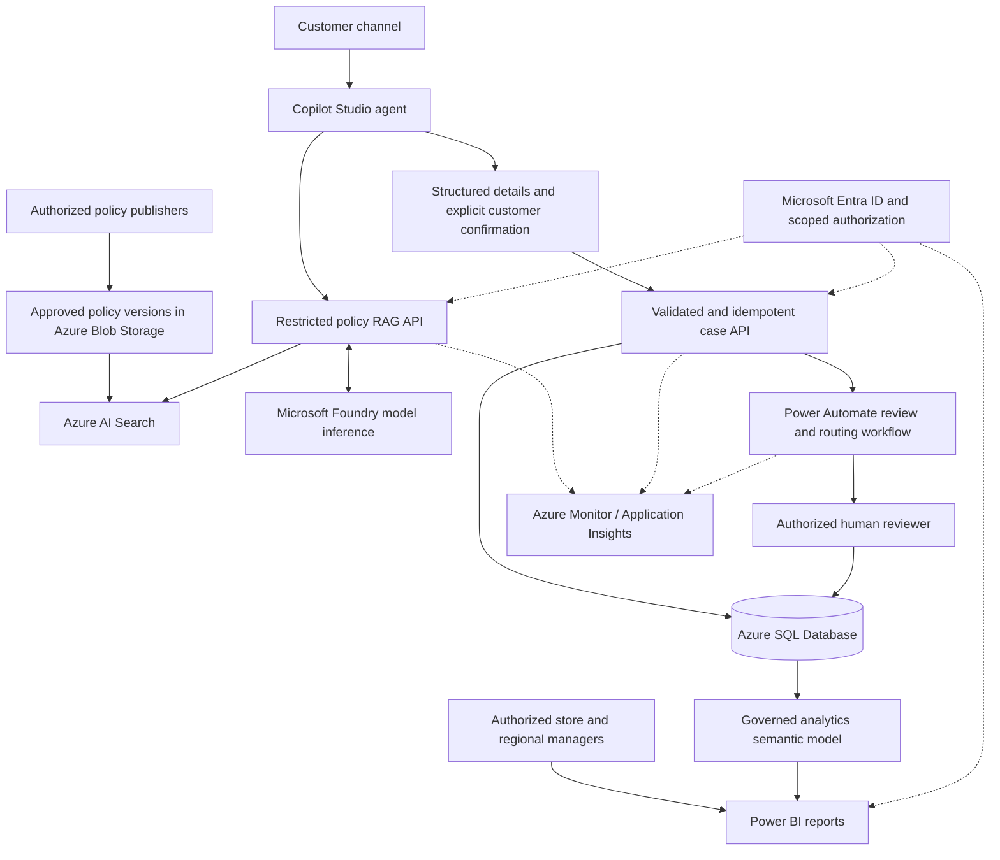

# Proposed Microsoft enterprise solution

This project uses synthetic retail data and fictional company policies for demonstration purposes.

**Status:** this document is an architectural proposal, not a deployment guide
or a claim that the enterprise services below have been implemented. The current
POC is Streamlit, Python, SQLite/FTS5, Pandas, Plotly, and one deployed
DeepSeek-V4-Flash model in Microsoft Foundry.

## Start with the customer's outcomes

A real retailer would first agree on the support problem, policy ownership,
operational decision, and success criteria. The immediate goal is consistent
policy guidance and traceable complaint intake, not unrestricted agent autonomy.
Managers need trustworthy inspection and complaint signals before deciding
whether to investigate a store, supplier, transport, or handling process.

The proposed platform should preserve three invariants: cite authorized policy,
create cases only after validated confirmation, and leave refund decisions with
an authorized process and reviewer. This proposal does not add automatic refund
approval or payment initiation.

## Prototype-to-enterprise mapping

| Current prototype | Proposed Microsoft enterprise component |
|---|---|
| Streamlit customer chat | Copilot Studio customer service agent |
| Python RAG service and Foundry model inference | Microsoft Foundry plus Azure AI Search |
| Local Markdown policies and SQLite FTS5 | Governed policy publishing, Azure Blob Storage, Azure AI Search |
| SQLite operational tables | Azure SQL Database behind a restricted application API |
| Python complaint workflow | Validated case API plus Power Automate / Copilot Studio agent flow |
| Pandas and Plotly dashboard | Governed Power BI semantic model and reports |
| Local application logs | Azure Monitor / Application Insights |
| Local app without login | Microsoft Entra ID, scoped application authorization, managed identities |
| Local development | Appropriate Azure application hosting and CI/CD |

Every row is a migration option requiring implementation, security review,
licensing/capacity checks, and acceptance testing. The current API-key client
does not already implement managed identity.

## Proposed architecture

Connections are conceptual, not configured connectors. Confirm the supported
API/tool integration, identity delegation, licensing, region, and data policies
for the customer's actual Copilot Studio and Foundry environments.

## Why Foundry and RAG

Foundry provides a managed model deployment surface for grounded inference and
an environment in which a team can evaluate model behavior and operational
trade-offs. The POC already demonstrates genuine inference through its
OpenAI-compatible endpoint; it does not create a Foundry agent.

Azure AI Search could replace the small FTS5 index with a managed retrieval
layer, document metadata, access-aware filtering, and relevance tuning.
Start with the simplest retrieval approach that meets measured needs. Hybrid
keyword/vector retrieval and semantic ranking are options, not already
implemented features or a requirement to introduce additional models now.
Validate quality, latency, cost, feature availability, and governance before
choosing more complex retrieval.

RAG is preferable to fine-tuning for frequently changing refund policies:
authorized document versions can be published and reindexed without retraining
model weights. Retrieval also preserves provenance and supports removal of
superseded material. Fine-tuning may help a stable style or specialized task,
but it is not a reliable policy database, access-control mechanism, or source
of current citations.

Production policy publishing needs an owner, approval, effective/expiry dates,
rollback, index-freshness checks, and tests preventing contradictory versions
from being presented together. Retrieved text remains untrusted data. Preserve
explicit abstention, citation validation, adversarial evaluation, and escalation.
Do not treat a second call to the same model as an independent factual oracle.

## Copilot Studio and complaint automation

Copilot Studio could accelerate channel integration, structured conversations,
handoff, and business-owned agent maintenance. This is valuable when a service
team needs to evolve customer journeys without rebuilding a custom interface
for every channel. Keep specialized retrieval behind a controlled API if that
provides clearer grounding, evaluation, or authorization boundaries.

Power Automate or a Copilot Studio agent flow could route a confirmed complaint
to the right store, notify an authorized team, track review deadlines, and
update case status. Preserve deterministic server-side validation and
idempotency; a flow retry must not create a second case. Record the actual
persisted Case ID before acknowledging success. Audit review decisions and
failed or delayed workflow steps.

The language model should not receive unrestricted SQL access or payment tools.
Only a narrowly scoped case API should create a complaint after explicit
confirmation. A review request is not a promised refund.

## Azure SQL and Power BI

Azure SQL Database could provide managed relational storage, concurrency,
backup/recovery, and controlled access. Reuse relational integrity, money stored
in integer cents or an appropriate fixed-precision type, unique submission
tokens, and transactional writes. A migration requires reviewed schema changes,
data reconciliation, connection management, and recovery testing; it is not a
connection-string-only replacement for SQLite.

Power BI is suitable for a governed enterprise semantic model, reusable
measures, distribution to managers, and role-scoped reporting. Define weighted
freshness from passed/inspected kilograms rather than averaging store rates.
Agree on comparable-period revenue growth and a defensible complaint-rate
denominator. Publish clear data freshness and source lineage.

Choose Import versus DirectQuery according to latency, source load, cost, and
governance needs. A newly created case is not automatically visible immediately
in every Power BI configuration; specify and test refresh/visibility SLAs.
Use appropriate workspace permissions and row-level security, testing the
actual consumer and privileged roles rather than assuming RLS protects all
workspace users.

## Identity, authorization, and data separation

The current application's tabs are **not** a security boundary. A real design
must separate:

| Surface | Data and access boundary |
|---|---|
| Public customer support | Approved public policies only; no internal sales, other customers' cases, or management content |
| Customer complaint API | Restricted case creation; any case lookup requires an appropriate verified identity and object-level authorization |
| Staff operations | Entra-authenticated users with application roles and store/region scope checked server-side |
| Management analytics | Authorized semantic model/report access, appropriate RLS, and least-privilege data connections |
| Workload-to-service access | Managed identities and narrowly scoped data-plane permissions where supported |

Azure RBAC governs supported Azure resource access; it does not replace
application authorization, SQL permissions, or Power BI access controls.
Test both allowed and denied paths. Plan private connectivity where justified,
secret management for unavoidable credentials, encryption, retention, audit
access, and redaction. Confirm customer identity and jurisdiction/privacy
requirements before collecting real information.

## Observability and measurable outcomes

Azure Monitor and Application Insights could collect correlated request traces,
latency, error rates, dependency failures, model usage/cost, and complaint
workflow outcomes. Configure redaction and retention before collection: do not
log API keys, hidden reasoning, or unrestricted customer transcripts by default.
Use case/request identifiers for diagnosis, with authorized access to the
underlying record rather than embedding sensitive content in logs.

Establish a baseline and agree targets with the customer before claiming value:

| Outcome | Example measure and evaluation |
|---|---|
| Consistent support | Human-reviewed policy accuracy, grounded citation support, correct abstention, false refund-promise rate |
| Customer experience | Median and p95 response latency, submission completion, satisfaction, accessibility |
| Service efficiency | Handling time and first-contact resolution compared with the prior process |
| Reliable workflow | Valid cases saved, duplicate rate, time to review, failed-routing recovery |
| Operational awareness | Time from complaint to manager visibility; time to investigate verified quality issues |
| Sustainable operations | Cost per grounded interaction, availability, error budget, and support effort |

The POC demonstrates a record flowing to a dashboard and calculated signals.
It does **not** demonstrate a measured reduction in costs, complaints, spoilage,
or sales loss. A controlled pilot and operational review would be required.
Correlations do not establish causation.

## Production-readiness gates

1. Agree on scope, owners, policy governance, human escalation, and permitted actions.
2. Complete privacy/threat reviews, separate public/internal data, and test least privilege.
3. Build and evaluate the approved policy index and model contract, including
   multilingual wording, missing evidence, contradictory policies, and injection attempts.
4. Migrate and reconcile data; validate retry safety, concurrent writes,
   audit history, retention, backup, and restore procedures.
5. Set latency/availability/visibility objectives; load-test quotas, failure
   behavior, workflow recovery, and monitoring alerts.
6. Establish reviewed CI/CD, environment separation, dependency management,
   deployment rollback, cost controls, licensing, and operational ownership.
7. Pilot with agreed baselines and human oversight before broad rollout.

## Microsoft references

- [Azure AI Search for RAG](https://learn.microsoft.com/en-us/azure/search/retrieval-augmented-generation-overview)
- [Microsoft Copilot Studio overview](https://learn.microsoft.com/en-us/microsoft-copilot-studio/fundamentals-what-is-copilot-studio)
- [Power Automate overview and getting started](https://learn.microsoft.com/en-us/power-automate/getting-started)
- [Azure SQL security overview](https://learn.microsoft.com/en-us/azure/azure-sql/database/security-overview)
- [Power BI row-level security](https://learn.microsoft.com/en-us/fabric/security/service-admin-row-level-security)
- [Azure Monitor Application Insights](https://learn.microsoft.com/en-us/azure/azure-monitor/app/app-insights-overview)
